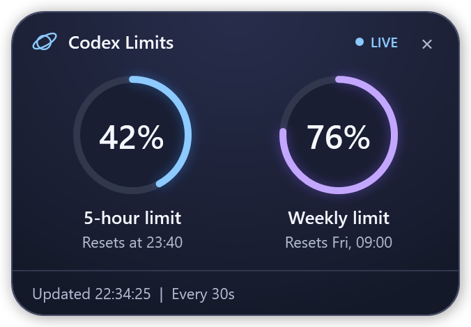

# Codex Limits · Orbit

Orbit is an always-on-top Windows widget for Codex usage limits and recent local Codex chats.

## Run or move the widget

1. Copy the entire `codex-limits-widget` folder to any folder on the destination Windows PC. Keep the PowerShell script and the launcher together.
2. Make sure Windows PowerShell with WPF and Windows Script Host are available. Orbit uses the Codex App Server executable bundled in the local Codex installation or a compatible `codex.exe` on `PATH`. Sign in to Codex with the account whose limits you want to see.
3. Double-click [codex-limits.vbs](codex-limits.vbs). The widget opens near the top-right corner. Drag its header to move it, or click **×** to close it.

Click **›** beside **×** to tuck Orbit into a compact tab on the right edge of the current monitor. The upper mini ring shows the 5-hour limit and the lower ring shows the weekly limit. Drag the tab up or down to move it along the edge. Click it to restore the full widget at the selected height, with the previous panel state.

Orbit uses the destination PC's Codex sign-in and local chat history. Copying the widget folder transfers the widget and its documentation.

## What the widget shows

- **Usage rings.** The blue and violet rings show the percentage used in the short and weekly windows returned by Codex. Each ring shows its next reset time and turns amber at 90% usage.
- **Recent chats.** Click **Context** to see the three most recently active local Codex chats across projects. The percentage shows the context remaining at the last locally recorded measurement and turns peach below 15%. While the panel is collapsed, **Context** turns peach when any of those three chats falls below 15%. **Waiting for data** means a measurement is unavailable for that chat.
- **Refresh and status.** Orbit checks for updates about every 30 seconds without starting a model turn. Opening **Context** requests a fresh check. **WAIT** appears during startup, **LIVE** means the latest limits check succeeded, and **OFFLINE** means it failed. **Checked** records the last successful chat check separately.

Orbit reads account limits and the [local Codex thread store](https://learn.chatgpt.com/docs/app-server#list-threads-with-pagination--filters) through the Codex App Server. Personal ChatGPT conversations, including those on a phone, use separate history. To save a copy of that history, use [ChatGPT data export](https://help.openai.com/en/articles/7260999-how-do-i-export-my-chatgpt-history-and-data).

## Troubleshooting

If the widget shows **Codex CLI was not found**, check that the bundled Codex executable exists or that `codex.exe` is on `PATH`. If it stays **OFFLINE**, check the Codex sign-in. Run the following command from the widget folder to test the limits connection.

```powershell
powershell.exe -NoProfile -ExecutionPolicy Bypass -File .\codex-limits.ps1 -Check
```

The widget's WPF layout and logic are in [codex-limits.ps1](codex-limits.ps1).

## Design history

- **Version 2.0 · November 9, 2026.** The compact layout places **Checked** to the right of **Recent chats**, above the three chat rows.
- **Version 2.0 · Edge tab.** Added a compact right-edge state with live mini rings and one-click restore. The tuck chevron and close button sit together beside **LIVE**.
- **Version 2.0 · Edge tab drag.** The tucked tab can move vertically along the right edge. Clicking it opens Orbit at the selected height.
- **Version 2.0 · Context warning.** The collapsed **Context** button highlights low context among the three recent chats.

The previews use sample data.

| Version 1.0 | Version 2.0 |
| --- | --- |
|  |  |


