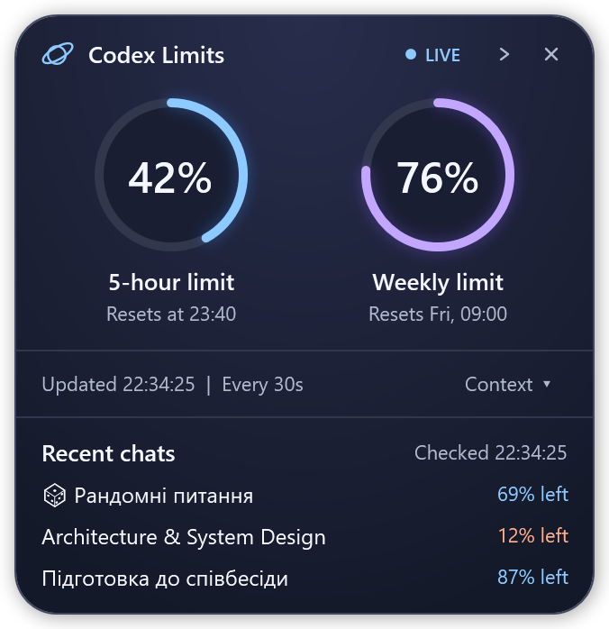
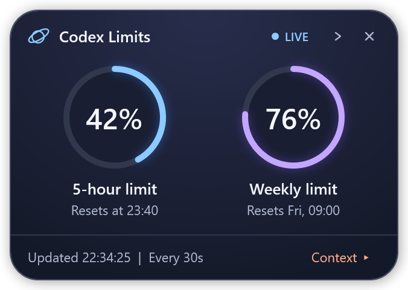

# Codex Limits · Orbit

Orbit is an always-on-top Windows widget for Codex. See how much of your 5-hour and weekly limits you’ve used, when they reset, and how much context remains in your three most recent local Codex chats.

| Full widget | Context warning | Edge tab |
| :---: | :---: | :---: |
|  |  |  |

*Previews use sample data.*

## Getting started

1. Download or clone this repository on Windows. Keep the launcher and PowerShell script in the same folder.
2. Sign in to Codex on that PC. Orbit uses the Codex executable bundled with the desktop app or a compatible `codex.exe` on `PATH`. The launcher requires Windows Script Host and Windows PowerShell with WPF.
3. Double-click [codex-limits.vbs](codex-limits.vbs). Drag the header to move Orbit, or click **×** to close it. Double-click the same launcher to reopen it.

## Using Orbit

- **Usage.** The two rings show usage and reset times. A ring turns amber at 90% used.
- **Context.** Open the panel to see the three most recently active local Codex chats across projects. A percentage turns peach below 15% remaining. When the panel is closed, the **Context** button picks up the same color if any of the three chats crosses that threshold. Personal ChatGPT conversations are outside this local history.
- **Edge tab.** Click **›** next to **×** to tuck the widget into the right edge of the current monitor. The upper mini ring shows the 5-hour limit and the lower ring shows the weekly limit. Drag the tab vertically to reposition it; click it to restore the widget at that height.
- **Refresh.** Orbit checks about every 30 seconds. **LIVE** means the latest limits check succeeded; **Checked** shows the time of the last successful chat check. Opening **Context** requests a fresh check.

On another PC, Orbit uses that PC’s Codex sign-in and local chat history.

If Orbit stays **OFFLINE**, check your Codex sign-in. To test the connection, run this from the widget folder:

```powershell
powershell.exe -NoProfile -ExecutionPolicy Bypass -File .\codex-limits.ps1 -Check
```
